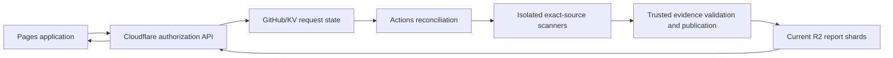

# Current service architecture

Current as of 2026-10-02. See [handoff](../HANDOFF.md) and
[current state](../current/CURRENT_STATE.md) for deployment evidence and remaining exceptions.

## Ownership

`combustrrr/code-analysis-dashboard` owns the React/TypeScript/Ant Design UI,
Cloudflare Worker, trusted scanner adapters, reusable workflows and current reports.
Agentic SOC runtime and product CI are independent. The product fork and Kavach
upstream are observer sources; the App is installed only on the service repository.
Native feedback is disabled for every configured project, including connected
self-analysis. Reports remain service-managed and never upload SARIF/checks or write to
an analyzed source.

## Request and result path

The Worker uses GitHub App/user authorization for repository inspection, reviewed
installation/configuration, launch, activity and report access. It does not execute
source code. GitHub reads are retried only for transient responses and detected
secondary-rate-limit responses, up to two retries; `Retry-After` is honored but capped
at 10 seconds per wait. R2 stores current reports and temporary producer artifacts; KV
stores service state. Keep free-plan usage bounded; do not purchase services
automatically.

The default-branch `.github/code-analysis/projects.json` contains execution identity,
source projects, profiles, scanner setup and immutable tooling. Installation writes
small wrappers and a profile only after an owner reviews and confirms exact files.
Admin is required for configuration; current collaborator access is required for scan requests. Branch
protection blocks a direct commit rather than being bypassed.

The Worker application policy refactor keeps portable-profile detection and validation
in `analysis-launcher/profile-policy.mjs`; `application.mjs` imports and re-exports
that policy instead of carrying a second copy. The refactor also removes the obsolete
inline/dead implementation. This is a code-organization change, not evidence that
external repository onboarding is fully verified.

Only explicit manual requests enter the bounded global FIFO. Branch and pull-request
inventory is read-only; events and schedules cannot invent scan work. Reconciliation
recovers accepted durable requests and processes one source revision globally. All
selected missing lane groups fan out within that request against the same pinned SHA.
Exact run/attempt provenance is mandatory. Source-only reuse requires matching source,
tooling and profile; PR-specific evidence retains context. Portable source scripts
execute without publishing/vendor credentials. Opt-in vendor jobs consume a snapshot
created by a separate credentialless checkout and do not execute project-controlled
commands. Trusted publication remains separate.

## Current-report lifecycle

GitHub/KV state holds scheduler/request state and R2 holds namespaced current-report
assets. Storage keys are qualified by the execution repository as
`repositories/<owner>/<repo>/...`; the public API route shape remains unchanged.
Each project keeps one current source-only report plus at most one separately keyed
current PR overlay. Upload replacement assets before changing manifest references; delete
unreferenced assets only afterward. Only a complete discovery pass removes deleted
targets. Late/superseded or mixed-revision results cannot overwrite current heads.
A valid partial report can publish, with the strict publication-gate evidence kept
honest. Completeness is separate from report validity and finding severity.

Temporary R2 producer artifacts are short-lived handoff evidence. Current reports use compressed
shards with a 100 MB asset bound and default 900,000,000-byte project budget.
Capacity failures retain prior valid reports, not silently omit targets. Pages
contains application assets only; the obsolete aggregate 900 MB Pages report limit
is not the report budget. Data publication neither rebuilds UI nor runs scanners.

The UI loads selected-target manifests and details through the Worker, polls active
requests every 15 seconds and reports about every minute, and shows workflow progress
separately from published findings. Access and rate-limit failures remain explicit.
See [access](../operations/DASHBOARD-ACCESS.md), [maintenance](../operations/SCANNER-MAINTENANCE.md), and
[developer interface](../current/MONITORING_UI.md).

The Actions-side GitHub CLI wrapper applies a 120-second timeout to each request and
fails closed on timeout; it does not retry an ambiguous dispatch. Source-executing jobs
receive read-only repository permissions and no vendor or publication credentials.
Configured-source producer and reconciliation jobs have no native-feedback authority.
