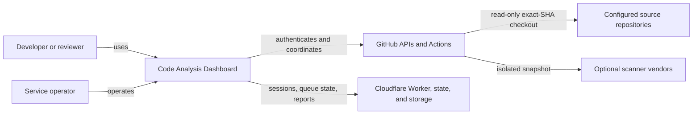
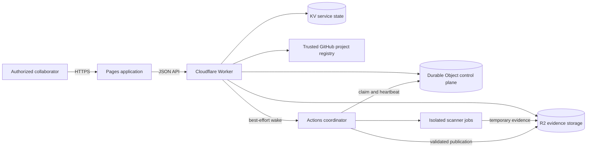
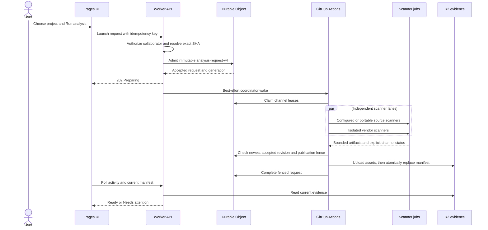

# System architecture

Status: **Authoritative for the deployed architecture**

Last reviewed: 2026-10-24

This document explains the stable structure of the Code Analysis Dashboard. It
describes responsibilities and trust boundaries, not individual deployment events.
For deployment acceptance and known limitations, see
[Production readiness](../operations/PRODUCTION_READINESS.md). For the reasoning behind
major choices, see the [architecture decisions](../decisions/README.md).

## Purpose

The service analyzes explicitly configured repositories at immutable Git SHAs and
publishes reviewable scanner evidence without modifying those repositories. Its main
users are developers and reviewers who need to answer four questions:

1. What exact source revision was analyzed?
2. Which scanner channels completed, failed, or were unavailable?
3. What findings and source locations did those scanners report?
4. Which workflow run, attempt, tooling revision, and profile produced the evidence?

## System context

## Containers

## Primary request flow

## Trust boundaries

| Boundary | Allowed | Prohibited |
|---|---|---|
| Browser to Worker | Opaque session handle and bounded API requests | GitHub access token, vendor secrets, raw service credentials |
| Worker to GitHub | OAuth identity checks, App-backed registry reads, workflow wake | Source execution |
| Source scanner job | Read exact source SHA and approved tooling | Vendor credentials, publication credentials, source writes |
| Vendor job | Read credentialless source snapshot and its own vendor secret | Repository checkout credentials, publication credentials |
| Publisher | Read producer artifacts and write validated report objects | Execute source-controlled commands |
| Public report API | Return authorized, bounded, sanitized evidence | Detected secret values or session material |

## Consistency and concurrency

- Admission is durable before the coordinator is woken.
- Different projects and revisions may analyze concurrently.
- Scanner lanes for one request run concurrently after identity validation.
- Matching active requests merge missing channels rather than duplicate work.
- Channel claims use generation and opaque lease-token fencing.
- Publication alone is serialized per project.
- A superseded or mixed-revision result cannot replace newer current evidence.
- A partial but valid report may publish; incomplete evidence remains explicit.

## Data ownership and retention

| Data | System of record | Retention behavior |
|---|---|---|
| Project configuration | `.github/code-analysis/projects.json` | Reviewed Git history |
| OAuth exchange and session metadata | Durable Object | Short-lived exchange, idle/grant expiry, explicit logout deletion |
| Analysis requests and leases | Durable Object | Bounded operational ledger and terminal history |
| Temporary producer evidence | R2 `temp-runs/` | One-day lifecycle |
| Current reports and PR overlays | Repository-qualified R2 keys | Replace-after-upload; delete only unreferenced assets |
| Workflow execution evidence | GitHub Actions | GitHub-configured artifact retention |
| Application assets | GitHub Pages | Current and recently referenced deployment assets |

## Failure behavior

- Authorization and identity ambiguity fail closed.
- A failed scanner does not erase healthy sibling evidence.
- A failed publication retains the previous valid current report.
- Missing, oversized, or corrupt assets are reported as unavailable, not as zero findings.
- A failed best-effort wake leaves the accepted request recoverable by reconciliation.
- Rate limits and transient GitHub failures are bounded and surfaced; they do not trigger
  unbounded retry loops.

## Code map

| Responsibility | Primary location |
|---|---|
| Browser application | `analysis-ui/` |
| Worker routing and OAuth | `analysis-launcher/worker.mjs` |
| Repository application API | `analysis-launcher/repository-api.mjs` |
| Durable sessions and analysis ledger | `analysis-launcher/auth-exchange.mjs` |
| Report reading and validation | `analysis-launcher/reports.mjs` |
| Trusted project registry | `.github/code-analysis/projects.json` and `analysis-launcher/target-registry.mjs` |
| Coordinator | `.github/workflows/code-analysis-coordinator.yml` |
| Scanner workflow generators | `scripts/code_analysis/generate_source_workflow.py` and `generate_reusable_workflows.py` |
| Evidence assembly and publication | `scripts/code_analysis/` |
| Scanner contracts and templates | `config/code-analysis/` |
| Security fixtures | `tests/security_canary/` |

## Related documents

- [Workflow architecture](WORKFLOWS.md)
- [Data handling inventory](DATA_HANDLING_INVENTORY.md)
- [Integration catalog](INTEGRATIONS.md)
- [Repository layout](repository-layout.md)
- [Authenticated launching](../current/AUTHENTICATED_LAUNCHING.md)
- [Read-only analysis runbook](../operations/READ_ONLY_ANALYSIS.md)
- [Migration boundaries](../MIGRATION.md)
